# AI Passport iFruit

把《GTA V》剧情模式里的手机带到 FoloToy AI Passport。选 Michael、Franklin 或 Trevor，用各自的皮肤收短信、查邮件、打电话或接听原版剧情来电。设备以 240×320 竖屏离线运行。

[编译和烧录](#编译和烧录) · [三键操作](#三键操作) · [文档索引](docs/README.md) · [当前验证状态](docs/verification.md) · [素材来源](assets/README.md)

从左到右是 Michael 的 iFruit、Franklin 的 Badger 和 Trevor 的 Facade。首页长按 OK 可以回到角色选择。

<p>
  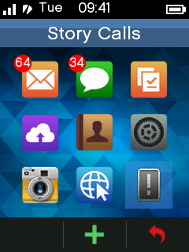
  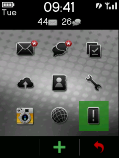
  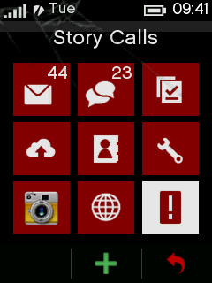
</p>

本文图片来自固件的主机 LVGL 预览，界面与预制内容以英文为主。

## 玩法

### 接听剧情来电

在 Michael 的桌面打开右下角的 **Story Calls**，选 Jimmy 的 `The stolen yacht`，按一次 OK 触发来电，再按 OK 接听。长按 OK 可以拒接或挂断。播放结束后回到刚才选中的条目。39 通 Legacy 原声按当前主角筛选，手动回放独立于任务进度。也可以在首页双击 OK 快速触发来电，或留在首页等自动来电。

<p>
  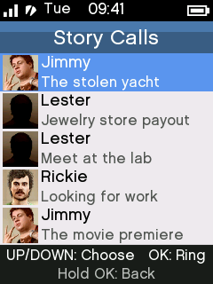
  
</p>

### 打电话、约朋友、叫出租车

在 **Contacts** 选择联系人拨号。支持好友邀约的联系人会出现 `Call` 和 `Hang Out`。目前有 35 位联系人的答录机，以及 12 组好友邀约的 36 段原版分支对白。日常通话可在 **Settings → Call history** 查看和回拨。

在通讯录长按上键打开 **Dial Pad**，可以直接选常用号码，也可以进 `Enter a number` 手动输入。拨打置顶的 Downtown Cab Co.（`323-555-5555`），能听到当前主角和接线员的原声对话，随后收到一条模拟派车短信。

<p>
  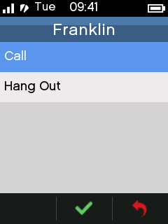
  
  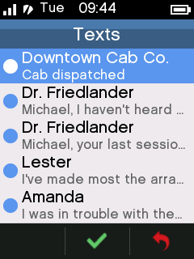
</p>

### 看短信和邮件

切换主角后，可以浏览各自的 **Texts** 和 **Email**。新内容会在桌面显示未读标记，短信正文带发件人头像。短按 OK 打开条目，上下滚动正文。剧情或邀约后补写的跟进短信会标明 `Local scene`。

<p>
  
  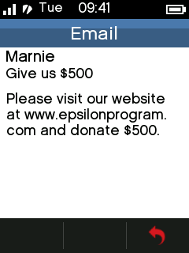
</p>

### 用 Snapmatic 拍照

打开 **Snapmatic → Take photo (demo)**，用上下键切换三位主角与洛圣都的预制画面。按 OK 快门，再按 OK 保存，长按 OK 取消。回到 **View photos** 就能浏览当前主角保存的照片。这些画面来自原版载入插画和城市背景，拍摄过程在设备上模拟。

<p>
  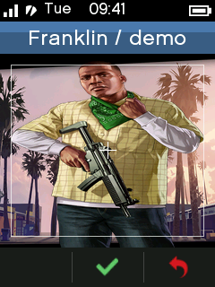
  
  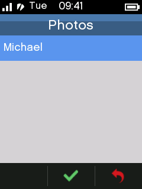
</p>

### 推进离线任务，查看账户

进入 **Check List → Open Missions** 查看开放任务。选中条目阅读简报，再按 OK 模拟完成。`Progress` 查看进度，桌面的 **Quick Save** 保存设备进度。**Internet → Account** 可查看虚拟余额与交易记录。Internet 里还藏了一个 Vice City 彩蛋。

<p>
  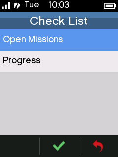
  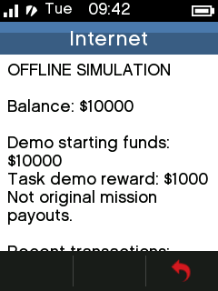
</p>

### 换壁纸和铃声

在 **Settings** 里可以从 10 张壁纸中选择，也能换主题和试听铃声。音量和屏幕亮度可用上下键即时调整，按 OK 确认。

<p>
  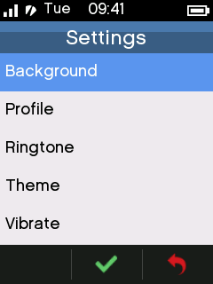
  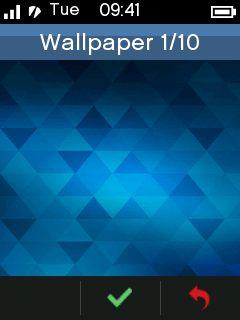
</p>

## 编译和烧录

硬件为 FoloToy AI Passport，ESP32-C3、8MB Flash。打开 **ESP-IDF 5.5.5 终端**，进入项目根目录执行：

```bat
idf.py -C firmware build
idf.py -C firmware -p COM5 flash monitor
```

将 `COM5` 换成实际串口。烧录后自动重启进入角色选择，按 `Ctrl+]` 退出串口监视器。普通更新会烧录程序和音频分区，并保留设置和存档。

`firmware/resources/` 随工程提供可直接编译的设备资源。日常构建只需 ESP-IDF 和工程组件。首次获取依赖、重新生成素材或合并烧录包的步骤见[开发与素材更新](docs/development.md)。

## 三键操作

- 首页用上、下键逐格选择，短按 OK 打开，**长按 OK 回到角色选择**。首页双击 OK 可快速触发一通当前角色的剧情来电。
- 列表上下选择，短按 OK 确认，长按 OK 逐级返回。来电时短按 OK 接听，长按 OK 拒接。
- 通讯录长按上键打开拨号盘，可选择常用号码或手动输入。设置中可打开通话记录、回拨和调整音量亮度。

## 实机截图

先退出串口监视器或网页烧录工具，双击根目录的 `screenshot.cmd`。也可指定串口：

```powershell
.\screenshot.cmd -Port COM5
```

实机截图保存到 `.local/screenshots/`，成功后自动打开。

## 项目结构

- [firmware/](firmware) 是完整 ESP-IDF 工程，包含 `main/`、`components/`、`resources/` 和分区配置。烧录文件输出到 `firmware/build/`。
- [assets/](assets/README.md) 按图片、字体和声音分类，`catalog/` 放预制数据与素材索引。
- [tools/](tools/README.md) 按设备、资源打包、原件提取和验证分目录。[tests/](tests) 放测试用例。
- [docs/](docs/README.md) 放使用说明与历史记录。本机提取缓存、截图和旧构建放在 Git 忽略的 `.local/`。
